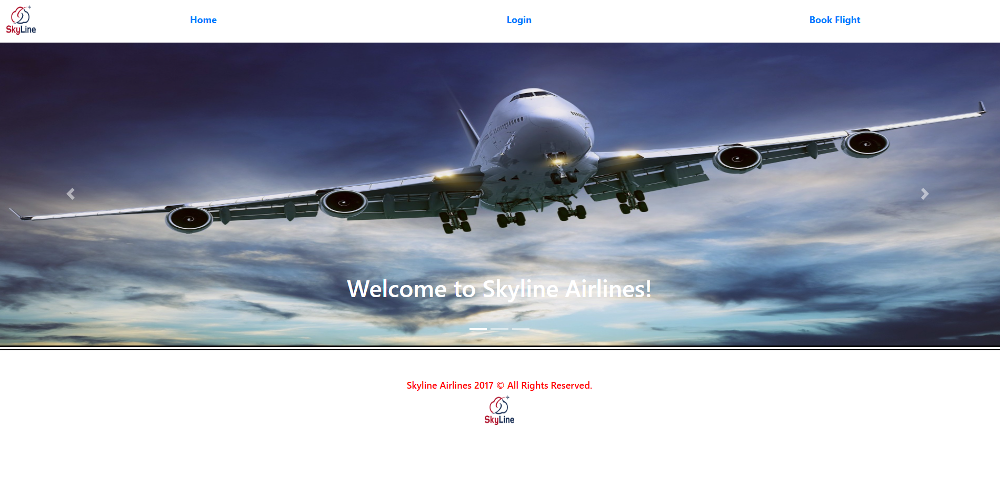
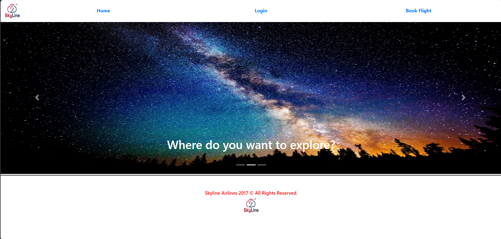
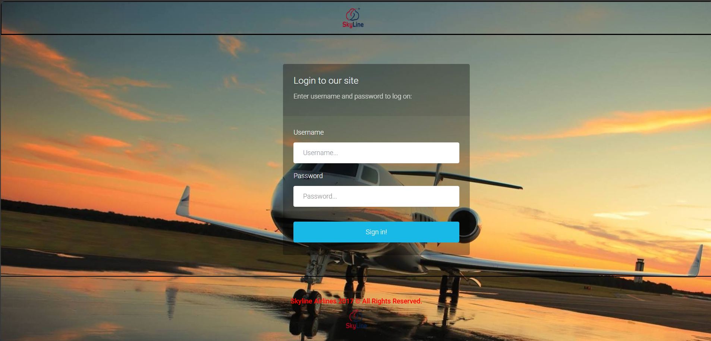
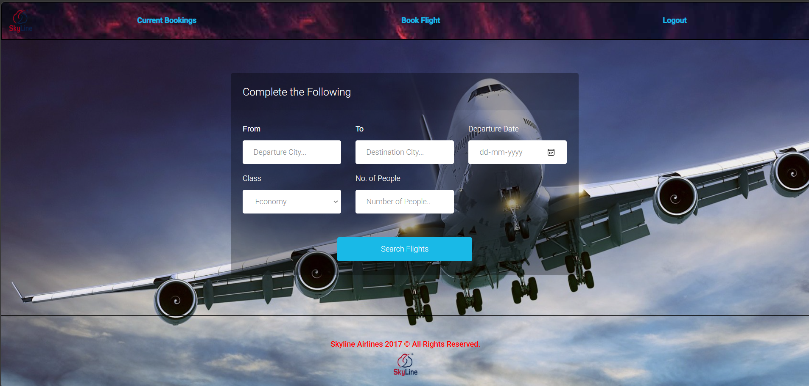
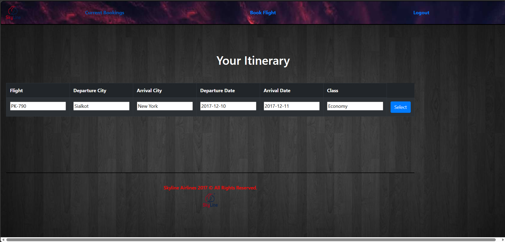
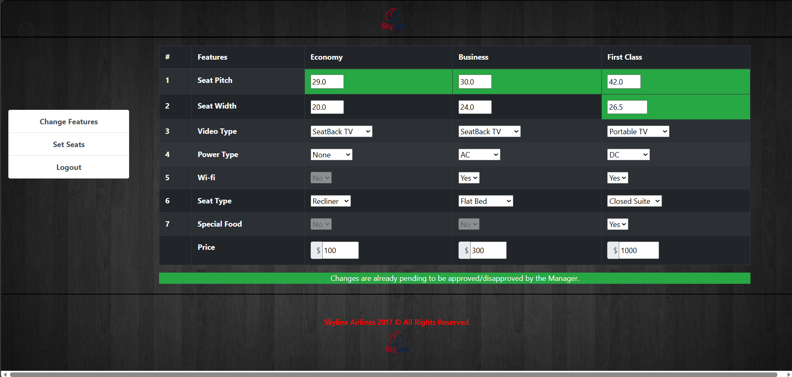
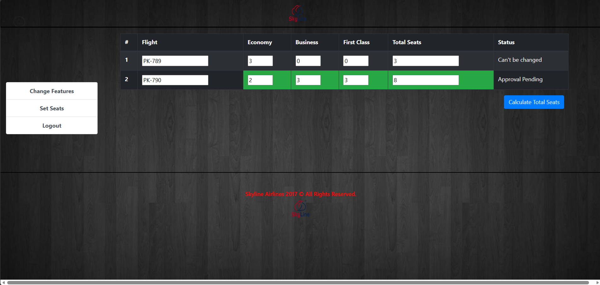
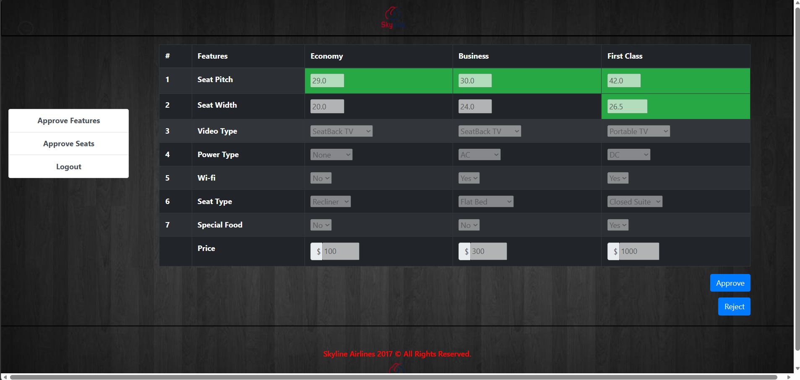
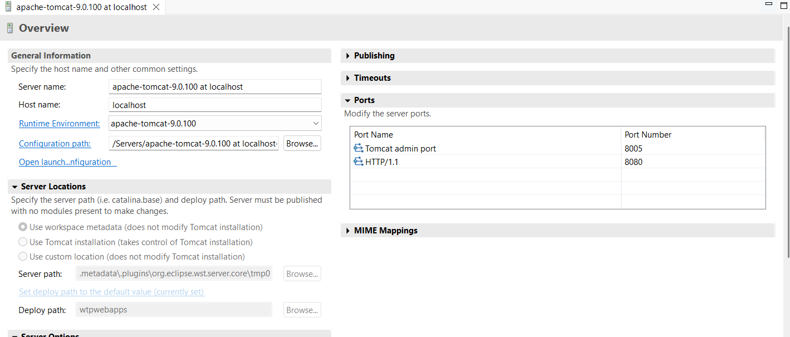
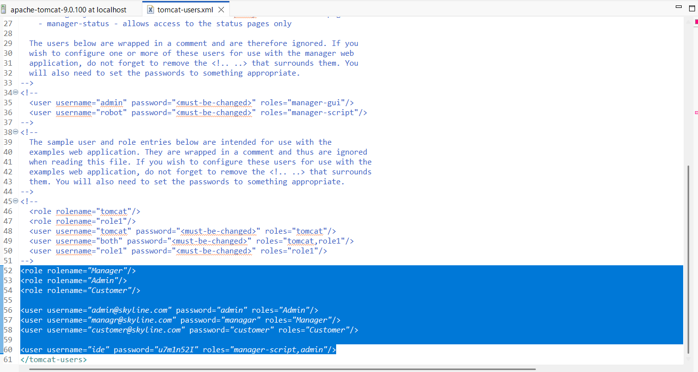

# Flight Booking System for Airlines (Java Web Application) ✈️ 

A **fully responsive** web-based Flight Booking System for Skyline Airlines based on the **Model View Controller (MVC) Architecture** made using **Java Servlets**, **Java Server Pages (JSPs)**, **Maven**. Moreover authentication and authorization for users is implemented using Tomcat Roles. The web-application is also secured against **SQL Injection** and **Cross-Site Scripting** attacks.

## Technologies Used

* **Frontend:** HTML, CSS, JavaScript, Jquery, Bootstrap, Java Server Pages (JSPs), AJAX (for a Flight Search Widget)
* **Backend:** Java Servlets, Java Models, H2 (Database) - In-Memory with some sample Data
* **Webservices:** SOAP Web Services (to get price and number of seats)
* **Security Features:** SQL Injection, Cross-Site Scripting (XSS), Tomcat Roles

## Roles
Following roles are implemented:
* Airline Admin
* Airline Manager
* Customer

## Workflow (Functionalities)

This is for just one airline who wants to sell seats to their customers via internet. 

Following are the steps of work flow:
1.   Airline Admin will set the prices of the seats. There should be three types of seats:
     *    First Class
     *    Business
     *    Economy
2.   The Airline Admin should be able to create and update the features of each type of seat. 
3.   The Airline Admin should be able to set the total number of seats for each flight.
4.   Airline Manager should see a list of seats which the Admin has added or edited when he/she logs in.
5.   Airline Manager then needs to approve the new price or updates.
6.   When the price and update is approved by the manager only then it should be available for the customer to buy.  
7.   The Customer should be able to buy seats based on availability.
8.   When a customer buys a ticket the system should be able to calculate how many seats are left. If all seats are bought the application should   not let the customers buy 
more seats. 
9.   The Customer should be able to select the following, to select a seat:
      *    origin and destination cities
      *    dates of travel
      *    number of people traveling
10.   When the customer selects the seat and confirms the booking flight Itinerary should 
be shown to the customer. 
11.   When the customer approves the itinerary the customer should be taken to a payment page where the total price should be shown. When the customer presses 
the pay button consider the transaction done and mark the seat sold. 
12.   Once the seat is sold, send out an email to the customer with the flight itinerary.

## Interface

#### Home Pages
<p align="middle">
   
   
</p>

#### Login Page and Book Flight
<p align="middle">
   
   
</p>

#### Current Bookings and Itinerary
<p align="middle">
   
</p>

#### Seat Features and Approval
<p align="middle">
   
   
   
   
</p>


## How to Run

1- Install these:
 * [Java SE Development Kit 8 (JDK 8)](http://www.oracle.com/technetwork/java/javase/downloads/jdk8-downloads-2133151.html)
 * After installing JDK 8, install [Eclipse IDE](https://www.eclipse.org/downloads/) with **all** the features including **Tomcat Apache Server.** 

2- Open Eclipse IDE and go to Windows > Show View > Servers > Add Server > Apache Tomcat. Open the "apache tomcat " folder and then the "**tomcat-users.xml**" file there. Copy the following lines and paste them in the tomcat-users.xml file before closing tag </tomcat-users>

```
<role rolename="Manager"/>
<role rolename="Admin"/>
<role rolename="Customer"/>
 
<user username="admin@skyline.com" password="admin" roles="Admin"/>
<user username="manager@skyline.com" password="manager" roles="Manager"/>
<user username="customer@yash.com" password="customer" roles="Customer"/>
<user username="durgesh@yash.com" password="durgesh" roles="Customer"/>
<user username="ashutosh@yash.com" password="ashutosh" roles="Customer"/>

 
<user username="ide" password="u7m1n52I" roles="manager-script,admin"/>
```

<p align="middle">
   
   
</p>

Morever, open and read the file. Only the users authenticated in this file are allowed to login and use the Booking System. Use above mentioned credentials to login through the Login Page.

3- Restart Eclipse IDE. Click on File -> Open Project and browse to the downloaded folder.


 


## Contributions Welcome
[](#)

If you find any bug in the code or have any improvements in mind then feel free to generate a pull request.


Copyright (c) 2026                                                        
